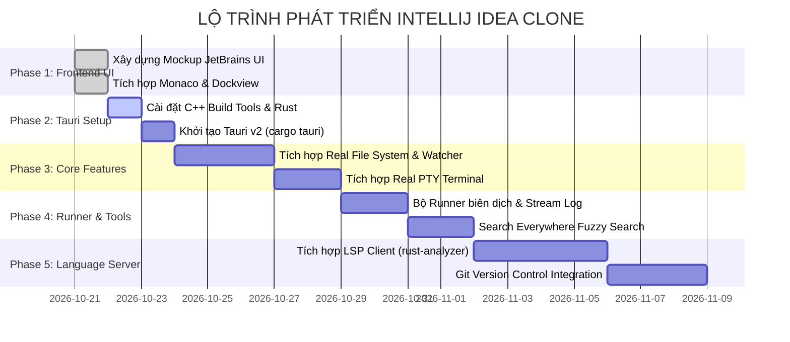

# KẾ HOẠCH DỰ ÁN INTELLIJ IDEA CLONE & TỔNG HỢP CÁC SKILLS CẦN THIẾT

> **Tài liệu tổng hợp bối cảnh, lịch sử hội thoại, kiến trúc hệ thống và ma trận kỹ năng (Developer & AI Agent Skills) phục vụ phát triển ứng dụng Desktop IDE phong cách JetBrains IntelliJ IDEA.**

---

## 1. Tóm Tắt Cuộc Hội Thoại & Tiến Trình Dự Án (Conversation Recap)

Qua các phiên làm việc và thảo luận trước đó, dự án đã xác định các mục tiêu và cột mốc cốt lõi:

1. **Ý tưởng khởi nguồn:**
   * Nhu cầu xây dựng một công cụ IDE/Editor desktop hoàn chỉnh từ đầu, mang phong cách giao diện và trải nghiệm tương tự **JetBrains IntelliJ IDEA** (New UI & Darcula).
   * Cân nhắc giải pháp công nghệ: Thay vì dùng Java/Swing nguyên bản (nặng nề) hay Electron (tốn RAM), giải pháp được lựa chọn là **Tauri v2 + Rust + React/TypeScript**.
   * Lợi thế: Backend Rust mang lại tốc độ native, bảo mật và tiêu thụ cực ít tài nguyên; Frontend Web (React + Tailwind + Monaco Editor) mang lại sự linh hoạt tối đa trong việc tùy biến giao diện giống hệt IntelliJ.

2. **Giai đoạn chuẩn bị môi trường & Xử lý thắc mắc cài đặt:**
   * Để biên dịch Rust và Tauri trên Windows, hệ thống bắt buộc cần **Visual Studio C++ Build Tools** (MSVC compiler và Windows SDK).
   * Người dùng đã chuẩn bị cài đặt C++ Build Tools và đặt câu hỏi về các thành phần cần tích chọn khi cài đặt.
   * Để không làm gián đoạn trải nghiệm, người dùng đã yêu cầu: *"Tôi sẽ cài C++ build tool, bạn cho tôi UI trước của IDE đi đã"*.

3. **Hiện thực hóa giao diện Mockup Frontend (Đã hoàn thành):**
   * Đã thiết lập thành công dự án React 18 + Vite + TypeScript + Tailwind CSS tại thư mục `d:\IDE`.
   * Tái hiện đầy đủ phong cách **JetBrains New UI**:
     - **TopBar**: Main Menu (File, Edit, View...), Run/Debug widget (nút Run ▶ xanh đặc trưng, Stop ⏹), Project selector, Branch Git, nút Search Everywhere.
     - **Activity Bar (Tool Window Stripe)**: Các tab điều hướng dọc (Project, Structure, Git, Bookmarks, Search).
     - **Project Tree**: Cây thư mục dự án với icon mở rộng/thu gọn và xem trước file.
     - **Dockview Layout**: Hệ thống dock panel kéo thả chuyên nghiệp chia màn hình linh hoạt.
     - **Monaco Editor**: Trình soạn thảo tích hợp theme IntelliJ Darcula, breadcrumbs, hiển thị tab đa nhiệm.
     - **Search Everywhere Modal (`Shift + Shift`)**: Cửa sổ tìm kiếm nhanh toàn diện (All, Classes, Files, Symbols, Actions).
     - **Bottom Panels**: Tab Console Run giả lập log biên dịch và Tab Terminal tích hợp xterm.js.
     - **Status Bar**: Hiển thị Git branch, trạng thái mã hóa (UTF-8), tọa độ dòng/cột (Ln, Col), và thanh tiến trình Indexing.

---

## 2. Hướng Dẫn Cài Đặt Môi Trường (Prerequisites Checklist)

Giải đáp chi tiết câu hỏi: **"Install thì cần check gì?"** khi cài đặt Visual Studio Installer:

### A. Visual Studio C++ Build Tools (Bắt buộc cho Rust/Tauri trên Windows)
Khi mở **Visual Studio Installer**, tại thẻ **Workloads (Khối lượng công việc)**:
* Tích chọn mục: **Desktop development with C++** (Phát triển ứng dụng máy tính để bàn với C++).
* Tại bảng bên phải **Installation details**, đảm bảo các mục sau được chọn:
  1. `MSVC v143 - VS 2022 C++ x64/x86 build tools` (hoặc phiên bản mới nhất).
  2. `Windows 10 SDK` hoặc `Windows 11 SDK` (ví dụ: `Windows 11 SDK (10.0.22621.0)`).
  3. `C++ CMake tools for Windows` (khuyên dùng).
  4. `C++ ATL for latest v143 build tools` (tùy chọn, tốt cho các thư viện C++ native).

### B. Rust Toolchain
* Tải và cài đặt từ trang chủ [rustup.rs](https://rustup.rs/).
* Khi chạy bộ cài `rustup-init.exe`: Chọn tùy chọn mặc định `1) Proceed with installation (default)` (sẽ tự động liên kết với `x86_64-pc-windows-msvc`).
* Kiểm tra sau khi cài đặt trong terminal:
  ```powershell
  rustc --version
  cargo --version
  ```

### C. Tauri CLI & Node.js
* Node.js phiên bản `>= 18` (đã có sẵn `npm`).
* Cài đặt Tauri CLI để phục vụ việc liên kết Backend Rust với Frontend:
  ```powershell
  npm install -D @tauri-apps/cli
  ```

---

## 3. Các Skill / Kỹ Năng Chuyên Môn Cần Thiết (Core Skills Matrix)

Để phát triển thành công một dự án Desktop IDE hoàn chỉnh, dự án đòi hỏi sự phối hợp của 3 nhóm kỹ năng lớn: **Kỹ năng Lập trình viên (Developer)**, **Kiến trúc Hệ thống IDE (Architecture)**, và **Bộ Kỹ Năng Trợ Lý AI (Antigravity Agent Skills)**.

```
                    ┌────────────────────────────────────────────────────────┐
                    │       HỆ SINH THÁI KỸ NĂNG DỰ ÁN INTELLIJ CLONE        │
                    └───────────────────────────┬────────────────────────────┘
                                                │
         ┌──────────────────────────────────────┼──────────────────────────────────────┐
         ▼                                      ▼                                      ▼
┌──────────────────┐                  ┌──────────────────┐                  ┌──────────────────┐
│ DEVELOPER SKILLS │                  │  IDE ARCHITECTURE│                  │ AI AGENT SKILLS  │
├──────────────────┤                  ├──────────────────┤                  ├──────────────────┤
│• Rust & Systems  │                  │• Virtual FS(VFS) │                  │• Frontend Dev/UI │
│• Tauri v2 IPC    │                  │• LSP Client      │                  │• Backend & Rust  │
│• React & TS      │                  │• PTY & Terminals │                  │• Debug & Fix     │
│• Monaco & Xterm  │                  │• Search & Index  │                  │• E2E Testing     │
│• Dockview layout │                  │• Runner & Build  │                  │• Plan & Roadmap  │
└──────────────────┘                  └──────────────────┘                  └──────────────────┘
```

---

### 3.1. Kỹ Năng Lập Trình Viên (Developer Competencies)

#### Nhóm 1: Lập trình Hệ thống với Rust (Systems Programming)
1. **Rust Core Fundamentals:**
   * Nắm vững cơ chế Ownership, Borrowing, Lifetimes, Smart Pointers (`Rc`, `Arc`, `RefCell`, `Mutex`).
   * Xử lý đa luồng & bất đồng bộ với **Tokio runtime** (async/await, mpsc channels, actor pattern).
   * Quản lý lỗi tường minh thông qua `Result<T, E>`, `Option<T>`, sử dụng các crate như `thiserror`, `anyhow`.
2. **Tauri v2 Framework & IPC:**
   * Định nghĩa các command IPC (`#[tauri::command]`) để cầu nối giữa Rust và Frontend.
   * Cơ chế Event Emitting (`app.emit(...)`) để truyền luồng dữ liệu thời gian thực (ví dụ: streaming output của terminal, tiến trình build).
   * Quản lý trạng thái ứng dụng (`tauri::State`) an toàn giữa các luồng.
3. **Quản lý Tiến trình (Process & PTY):**
   * Sử dụng crate `portable-pty` để khởi tạo PTY (Pseudo-terminal) thật trên Windows (ConPTY), cho phép chạy PowerShell/CMD/Bash tương tác hai chiều trong panel Terminal.
   * Quản lý spawn tiến trình con (Child Process) để chạy các lệnh build/run (`cargo run`, `npm run`, `javac`...).

#### Nhóm 2: Lập trình Frontend & Giao diện IDE (Frontend Engineering)
1. **React 18 / 19 & TypeScript nâng cao:**
   * Sử dụng thành thạo Custom Hooks để tách biệt logic điều khiển editor, file tree, terminal.
   * Tối ưu hóa hiệu năng render với `useMemo`, `useCallback`, `React.memo` để tránh lag khi gõ code nhanh.
   * Quản lý State toàn cục (Zustand hoặc React Context) cho các trạng thái: file đang mở, tab active, cấu hình run/debug.
2. **Tích hợp & Mở rộng Monaco Editor:**
   * Cấu hình `@monaco-editor/react`: tùy biến font chữ JetBrains Mono, line height, ruler, minimap.
   * Đăng ký custom language syntax và language server client trên Monaco.
   * Quản lý Monaco Models (mỗi tab tương ứng với 1 model text riêng biệt, giữ nguyên lịch sử Undo/Redo khi chuyển tab).
3. **Quản lý Layout Đa Nhiệm (Dockview):**
   * Nắm rõ API của thư viện `dockview` để tạo các split panels (trái, phải, dưới, giữa).
   * Lưu trữ và khôi phục trạng thái layout của người dùng vào `localStorage` hoặc cấu hình desktop.
4. **Tích hợp Terminal (Xterm.js):**
   * Cấu hình `@xterm/xterm` kết hợp `@xterm/addon-fit` để tự động co giãn kích thước terminal khi kéo thanh trượt.
   * Xử lý các mã màu ANSI, phím tắt đặc biệt (Ctrl+C, Ctrl+V, Tab completion).

---

### 3.2. Kỹ Năng Thiết Kế Kiến Trúc IDE (IDE Architecture & System Design)

1. **Hệ thống Quản lý Tệp Ảo (Virtual File System - VFS):**
   * Cơ chế đọc/ghi file bất đồng bộ không làm đơ giao diện.
   * Theo dõi sự thay đổi file trên đĩa cứng (File System Watcher) bằng crate `notify` trong Rust để tự động reload tab khi file bị sửa từ bên ngoài.
2. **Language Server Protocol (LSP) Client:**
   * Hiểu giao thức LSP chuẩn (JSON-RPC qua stdin/stdout).
   * Kết nối với các Language Server có sẵn (`rust-analyzer` cho Rust, `tsserver` cho TypeScript, `clangd` cho C/C++).
   * Cung cấp các tính năng: Go to Definition, Auto-completion, Hover doc, Inline Diagnostics (báo lỗi gạch chân đỏ/vàng).
3. **Cơ chế Indexing & Search Engine:**
   * Thuật toán tìm kiếm xâu ký tự mờ (Fuzzy Search) để hỗ trợ tính năng **Search Everywhere** (`Shift + Shift`).
   * Indexing cây thư mục và danh sách symbol trong nền (Background Indexing) với thanh tiến trình trực quan.
4. **Hệ thống Cấu hình Chạy & Gỡ lỗi (Run/Debug Configurations):**
   * Quản lý cấu hình chạy linh hoạt (JSON config tương tự `.idea/workspace.xml` hoặc `.vscode/launch.json`).
   * Phân tích cú pháp stdout/stderr để phân loại log (lỗi, cảnh báo, thông tin biên dịch) hiển thị lên Run Console.

---

### 3.3. Bộ Kỹ Năng Trợ Lý AI (Antigravity & ClaudeKit Agent Skills)

Trong môi trường Antigravity IDE, việc kích hoạt đúng các skill chuyên biệt sẽ giúp tối ưu hóa hiệu suất triển khai mã nguồn:

| Kỹ Năng (Agent Skill) | Vai Trò Trong Dự Án | Khi Nào Sử Dụng |
| :--- | :--- | :--- |
| **`ck:frontend-development`** | Xây dựng và mở rộng các component React, tối ưu State, quản lý Monaco Editor & Dockview. | Khi thêm mới các thanh công cụ, tabs, panel hoặc nâng cấp UI. |
| **`ck:frontend-design` & `ck:ui-styling`** | Tinh chỉnh chuẩn xác từng pixel theo phong cách JetBrains New UI & Darcula. | Khi đồng bộ màu sắc, icon, hiệu ứng hover, border, typography JetBrains Mono. |
| **`ck:backend-development`** | Thiết kế kiến trúc Rust, tổ chức module Cargo, quản lý Tokio async và luồng dữ liệu IPC. | Khi viết logic Tauri backend, giao tiếp tiến trình, VFS. |
| **`ck:debug` & `ck:fix`** | Phân tích và sửa chữa nhanh các lỗi phát sinh (Rust borrow-checker, C++ Linker, Node dependencies). | Khi gặp lỗi biên dịch Cargo hoặc lỗi render Monaco/xterm. |
| **`ck:test` & `ck:web-testing`** | Viết và chạy unit test cho các module, kiểm thử tự động e2e giao diện với Vitest/Playwright. | Đảm bảo tính toàn vẹn khi đóng/mở tab, chuyển file, gõ code. |
| **`ck:plan` & `ck:project-management`** | Phân rã mục tiêu lớn thành các phase rõ ràng, theo dõi tiến độ công việc. | Khi chuẩn bị bước sang giai đoạn tích hợp mới (như LSP hay PTY). |

---

## 4. Lộ Trình Phát Triển Các Giai Đoạn Tiếp Theo (Roadmap)



### Chi tiết các bước thực hiện tiếp theo:
1. **Bước 1 (Hiện tại):** Hoàn tất cài đặt Visual Studio C++ Build Tools theo hướng dẫn ở Mục 2.
2. **Bước 2:** Chạy lệnh khởi tạo Tauri trong thư mục dự án:
   ```powershell
   npx @tauri-apps/cli init
   ```
3. **Bước 3:** Viết IPC Command trong Rust (`src-tauri/src/main.rs`) để đọc danh sách thư mục và file thật trên máy tính, thay thế dữ liệu mockup hiện tại của `ProjectTree.tsx`.
4. **Bước 4:** Thêm crate `portable-pty` vào `Cargo.toml` để biến tab Terminal thành một PowerShell/CMD console hoạt động 100%.
5. **Bước 5:** Thêm tính năng chạy code thật (chạy lệnh biên dịch và xuất log ra Run Console).
