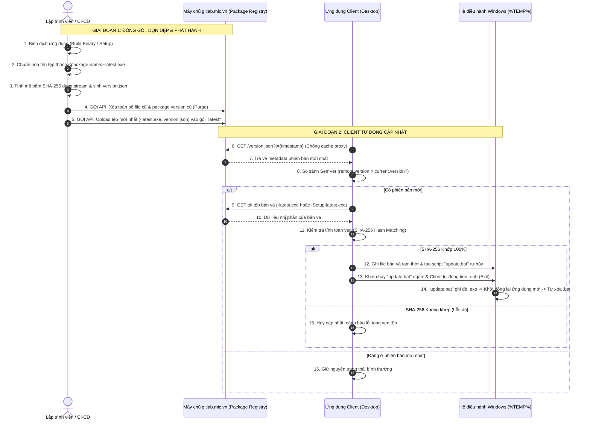

# HƯỚNG DẪN TRIỂN KHAI CẬP NHẬT PHIÊN BẢN TỰ ĐỘNG (AUTO-UPDATE) QUA GITLAB.MIC.VN
> **Tài liệu chuẩn hóa kiến trúc & hướng dẫn tích hợp tính năng Auto-Update dành cho các ứng dụng Desktop (Tauri, Electron, C# .NET...) trong hệ sinh thái MIC Studio.**

---

## 📑 MỤC LỤC
1. [Tổng Quan Kiến Trúc & Thiết Luật Bắt Buộc (Architecture & Iron Rules)](#1-tổng-quan-kiến-trúc--thiết-luật-bắt-buộc-architecture--iron-rules)
2. [Cấu Hình Dự Án Trên gitlab.mic.vn](#2-cấu-hình-dự-án-trên-gitlabmicvn)
3. [Chuẩn Hóa Metadata Phiên Bản (`version.json`)](#3-chuẩn-hóa-metadata-phiên-bản-versionjson)
4. [Kịch Bản Đóng Gói, Dọn Dẹp & Tải Lên Tự Động (`publish-update.cjs`)](#4-kịch-bản-đóng-gói-dọn-dẹp--tải-lên-tự-động-publish-updatecjs)
5. [Tích Hợp Phía Ứng Dụng Client (Frontend & Core)](#5-tích-hợp-phía-ứng-dụng-client-frontend--core)
6. [Quy Trình Vận Hành & Phát Hành Hàng Ngày](#6-quy-trình-vận-hành--phát-hành-hàng-ngày)
7. [Xử Lý Sự Cố Thường Gặp (Troubleshooting FAQ)](#7-xử-lý-sự-cố-thường-gặp-troubleshooting-faq)

---

## 1. TỔNG QUAN KIẾN TRÚC & THIẾT LUẬT BẮT BUỘC (ARCHITECTURE & IRON RULES)

### 1.1. Ba Thiết Luật Phát Hành Bản Cập Nhật (Three Iron Rules)

> [!IMPORTANT]
> **THIẾT LUẬT 1: LƯU TRỮ TẠI PACKAGE REGISTRY - CẤM COMMIT FILE BUILD VÀO GIT REPO**
> * Tuyệt đối **CẤM commit và push các tệp thực thi nhị phân (`.exe`), bộ cài đặt (`Setup.exe`) hay thư mục build (`release/`, `dist/`, `target/`)** vào nhánh Git repository. Git repo chỉ dùng để lưu trữ và quản lý mã nguồn (Source Code).
> * Mọi bản cập nhật phần mềm bắt buộc phải được xuất bản trực tiếp lên **GitLab Generic Package Registry** (`https://gitlab.mic.vn/<group>/<project>/-/packages`).

> [!IMPORTANT]
> **THIẾT LUẬT 2: TẠO MỤC (PACKAGE) RIÊNG BIỆT CHO TỪNG ỨNG DỤNG**
> * Trong Package Registry, mỗi ứng dụng hoặc công cụ trong hệ sinh thái MIC Studio phải sở hữu **đúng 1 mục Package độc lập** mang tên định danh của chính ứng dụng đó (ví dụ: `mic-git-studio`, `rustman`, `mic-thuyntt02-studio`, `mic-studio`, `custom-idea`).
> * Tuyệt đối không dùng chung một Package cho nhiều công cụ, không đẩy lẫn lộn tệp tin sang Package của dự án khác, và không sử dụng các thư mục generic chung chung.
> * Phiên bản định danh của Package trên GitLab luôn thống nhất đặt là **`latest`** (loại Generic Package).

> [!IMPORTANT]
> **THIẾT LUẬT 3: TÊN FILE KHÔNG CHỨA SỐ VERSION - CHỈ DÙNG ĐUÔI `-latest` & DỌN SẠCH BẢN CŨ**
> * **Quy chuẩn đặt tên tệp:** Tên tệp xuất bản lên GitLab **tuyệt đối không được chứa số phiên bản** (như `app-1.0.5.exe` hay `Setup-v2.1.exe`). Tên tệp bắt buộc gắn hậu tố **`-latest`**:
>   - Hot-patch nhị phân: `<package-name>-latest.exe` (Ví dụ: `custom-idea-latest.exe`).
>   - Bộ cài đặt Windows Setup: `<package-name>-Setup-latest.exe` (Ví dụ: `custom-idea-Setup-latest.exe`).
>   - Tệp metadata chỉ dẫn: `version.json`.
> * **Cơ chế Dọn dẹp Triệt để (Purge & Clean):** Khi xuất bản một bản mới lên GitLab, hệ thống bắt buộc phải **xóa sạch toàn bộ các tệp cũ và các package phiên bản cũ trước đó**, chỉ lưu lại DUY NHẤT các tệp của bản cập nhật mới nhất. Điều này đảm bảo Package Registry luôn tinh gọn, không phình to dung lượng ổ cứng máy chủ và tránh người dùng tải nhầm tệp cũ.

---

### 1.2. Cơ chế cập nhật 2 tầng (2-Tier Update Strategy)
Hệ thống hỗ trợ song song 2 hình thức cập nhật linh hoạt tùy theo mức độ thay đổi của phần mềm:

| Tiêu chí | ⚡ Tầng 1: Hot-patch Nhị phân (`-latest.exe`) | 📦 Tầng 2: Full Setup Installer (`-Setup-latest.exe`) |
| :--- | :--- | :--- |
| **Bản chất** | Chỉ tải file thực thi chính của ứng dụng và ghi đè | Tải bộ cài đặt Windows Setup hoàn chỉnh (NSIS/InnoSetup) |
| **Quy chuẩn đặt tên** | `<package-name>-latest.exe` | `<package-name>-Setup-latest.exe` |
| **Dung lượng** | **Siêu nhẹ** (chỉ từ 5 MB – 20 MB) | Dung lượng đầy đủ (từ 30 MB – 100+ MB) |
| **Thời gian cập nhật** | **Tức thì (1 – 3 giây)** qua script nền tự hủy | 1 – 2 phút (chạy wizard hoặc silent installer) |
| **Mục đích sử dụng** | Cập nhật logic code, sửa lỗi giao diện, thêm tính năng thường xuyên | Khi có nâng cấp lớn về runtime, thư viện DLL hệ thống, driver, hoặc cài đặt lần đầu |
| **Cách kích hoạt** | Mặc định cho mọi bản phát hành thông thường | Gắn cờ `"requireSetup": true` trong `version.json` |

---

### 1.3. Sơ đồ tương tác (Sequence Diagram)



---

## 2. CẤU HÌNH DỰ ÁN TRÊN GITLAB.MIC.VN

1. **`GITLAB_PROJECT_ID`**: ID dự án trên GitLab (Settings -> General).
2. **Package Registry**: Bật tại Settings -> General -> Visibility -> Package Registry = Enabled.
3. **Project Access Token**: Settings -> Access Tokens, Scope `api`, Role `Maintainer`.

---

## 3. CHUẨN HÓA METADATA PHIÊN BẢN (`version.json`)
```json
{
  "version": "1.2.0",
  "releaseDate": "2026-11-06T10:30:00.000Z",
  "notes": "• [Tính năng mới] Bổ sung giao diện tìm kiếm nhanh\n• [Sửa lỗi] Khắc phục lỗi tràn bộ nhớ khi tải tệp lớn",
  "sha256": "4a5c6e7f8a9b0c1d2e3f4a5b6c7d8e9f0a1b2c3d4e5f6a7b8c9d0e1f2a3b4c5d",
  "downloadUrl": "https://gitlab.mic.vn/api/v4/projects/299/packages/generic/custom-idea/latest/custom-idea-latest.exe",
  "size": 15420160,
  "forceUpdate": true,
  "requireSetup": false,
  "setupUrl": "https://gitlab.mic.vn/api/v4/projects/299/packages/generic/custom-idea/latest/custom-idea-Setup-latest.exe",
  "setupSha256": "8f7e6d5c4b3a201f9e8d7c6b5a403f2e1d0c9b8a7f6e5d4c3b2a109f8e7d6c5b",
  "setupSize": 45120300
}
```
