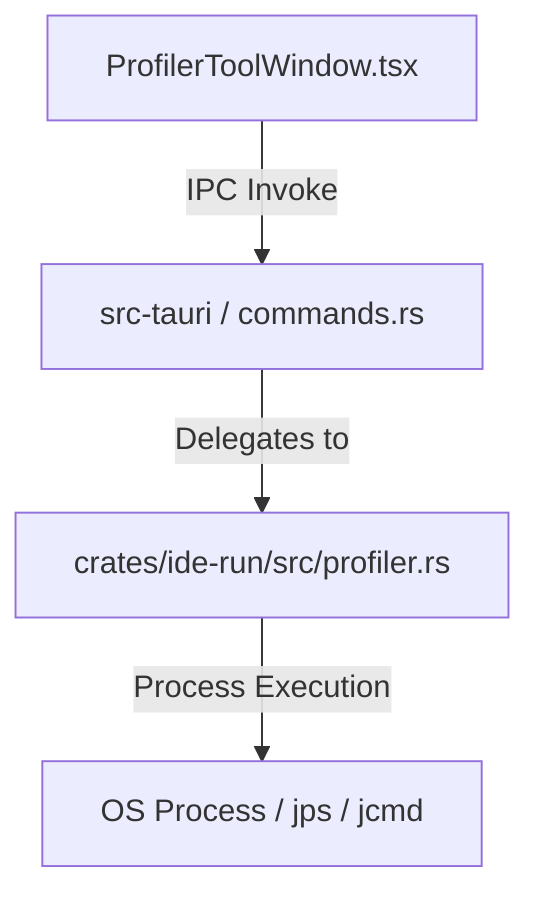

# Phase 2: Architectural Decoupling of Profiler Subsystem

## Overview

Relocate JVM Profiler commands, Java process discovery (`jps`), and diagnostic commands (`jcmd`) from `src-tauri/src/profiler.rs` into `crates/ide-run/src/profiler.rs`, restoring `src-tauri` as a pure application and IPC orchestration shell.

## Requirements

- Functional:
  - Migrate all profiler IPC commands: `get_process_metrics`, `list_running_java_processes`, `trigger_jvm_gc`, `trigger_jvm_heap_dump`.
  - Maintain identical command signatures and error handling so the frontend (`ProfilerToolWindow.tsx`) requires zero changes.
- Non-functional:
  - Keep domain logic contained inside domain crates (`crates/ide-run`).
  - Add unit tests for `jps` output parsing in `ide-run`.

## Architecture



## Related Code Files

- Create:
  - `crates/ide-run/src/profiler.rs`
- Modify:
  - `crates/ide-run/src/lib.rs` (export `pub mod profiler;` and re-export commands)
  - `src-tauri/src/lib.rs` (remove `pub mod profiler;`)
  - `src-tauri/src/commands.rs` (import commands from `process::profiler` or `process::*`)
- Delete:
  - `src-tauri/src/profiler.rs`

## Implementation Steps

1. Create `crates/ide-run/src/profiler.rs` and copy the implementation from `src-tauri/src/profiler.rs`.
2. Ensure necessary dependencies (`serde`, `serde_json`, `chrono`, etc.) are declared in `crates/ide-run/Cargo.toml` (all are already workspace dependencies).
3. In `crates/ide-run/src/lib.rs`:
   - Declare `pub mod profiler;`
   - Re-export the profiler commands:
     ```rust
     pub use profiler::{
       get_process_metrics,
       list_running_java_processes,
       trigger_jvm_gc,
       trigger_jvm_heap_dump,
     };
     ```
4. In `src-tauri/src/lib.rs`:
   - Remove `pub mod profiler;`.
5. In `src-tauri/src/commands.rs`:
   - Update command registration list from `crate::profiler::*` to `process::*`.
6. Add unit tests in `crates/ide-run/src/profiler.rs`:
   - Test `parse_jps_line` with various JDK output formats (standard jar, maven daemon, gradle daemon, IDE launcher).
   - Test CPU/memory percentage clamping logic.
7. Remove `src-tauri/src/profiler.rs`.
8. Run `cargo test -p ide-run` and `cargo check --workspace` to ensure clean compilation.

## Success Criteria

- [ ] `src-tauri/src/profiler.rs` is deleted.
- [ ] Profiler commands compile and pass unit tests within `crates/ide-run`.
- [ ] `src-tauri/src/commands.rs` cleanly registers the 4 profiler commands via `process::*`.
- [ ] `cargo check --workspace` succeeds with zero errors.

## Risk Assessment

- **Risk:** Command signatures change or mismatch frontend expectations.
  - **Mitigation:** Retain exact same function names, parameter names (`pid: u32`, `heap_dump_path: String`, etc.), and `Result<T, String>` return types.
