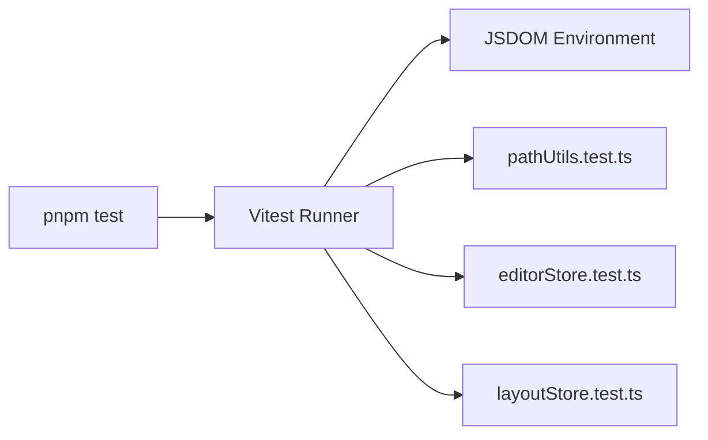

# Phase 4: Frontend Test Infrastructure and Critical Store Tests

## Overview

Establish the missing automated test infrastructure for the React/TypeScript frontend by integrating Vitest and writing regression unit tests for the core state machines (`editorStore`, `layoutStore`, `pathUtils`).

## Requirements

- Functional:
  - Add `vitest` and `jsdom` to devDependencies.
  - Add `"test"` script to `package.json` (`vitest run`).
  - Implement unit test suites verifying:
    1. `pathUtils.ts`: path normalization, Windows drive letter resolution, relative path calculation.
    2. `editorStore.ts`: tab opening, tab switching, closing active/inactive tabs, dirty state management.
    3. `layoutStore.ts`: active bottom tool window toggling, side bar collapse/expand state transitions.
- Non-functional:
  - Test suite must execute quickly (<5 seconds) without needing a running Tauri backend.
  - Zero interference with existing `pnpm build` (tsc + vite build).

## Architecture



## Related Code Files

- Create:
  - `vitest.config.ts`
  - `src/utils/pathUtils.test.ts`
  - `src/stores/editorStore.test.ts`
  - `src/stores/layoutStore.test.ts`
- Modify:
  - `package.json` (add dependencies and scripts)

## Implementation Steps

1. Install Vitest and test environment libraries:
   ```powershell
   pnpm add -D vitest @testing-library/react @testing-library/jest-dom jsdom
   ```
2. Create `vitest.config.ts`:
   ```typescript
   import { defineConfig } from 'vitest/config';
   import react from '@vitejs/plugin-react';

   export default defineConfig({
     plugins: [react()],
     test: {
       globals: true,
       environment: 'jsdom',
       include: ['src/**/*.test.{ts,tsx}', 'scripts/**/*.test.{js,mjs,cjs}'],
     },
   });
   ```
3. Update `package.json`:
   - Add `"test": "vitest run"`
   - Add `"test:watch": "vitest"`
4. Write `src/utils/pathUtils.test.ts`:
   - Test `resolveProjectPath` with Unix and Windows-style paths.
   - Test edge cases: root directory, empty string, duplicate slashes, backslashes.
5. Write `src/stores/editorStore.test.ts`:
   - Test initial state.
   - Test opening a file adds to `openTabs` and sets `activeTabId`.
   - Test closing active tab focuses adjacent tab.
   - Test closing unsaved dirty tab preserves correct state.
6. Write `src/stores/layoutStore.test.ts`:
   - Test toggling tool windows (`activeBottomToolWindow`).
   - Test sidebar expansion/collapse toggle logic.
7. Run `pnpm test` and ensure 100% of tests pass.

## Success Criteria

- [ ] `pnpm test` runs cleanly and reports passing test suites.
- [ ] Core stores (`editorStore`, `layoutStore`) and `pathUtils` have verified automated test coverage.
- [ ] No regression on existing `pnpm build` output.

## Risk Assessment

- **Risk:** Mocking Tauri IPC (`@tauri-apps/api`) inside store unit tests.
  - **Mitigation:** Ensure store tests focus on pure state mutations and mock `@tauri-apps/api/core` if imported.
