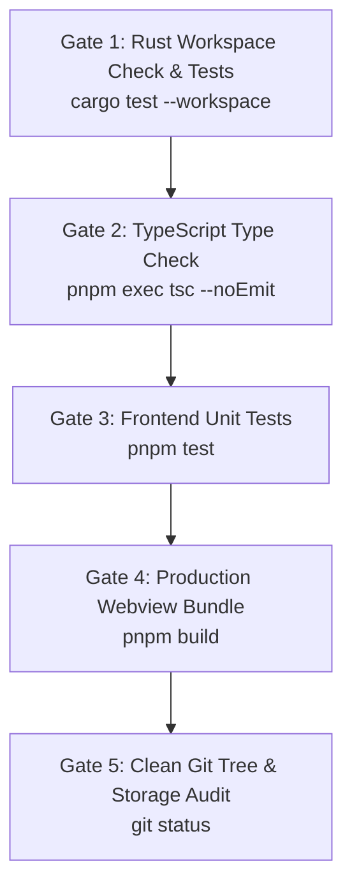

# Phase 5: Full Workspace Verification Gates and Build Sanity

## Overview

Execute comprehensive multi-stage verification gates across both backend (Rust workspace) and frontend (TypeScript, Vitest, Vite), validating zero regressions, clean git status, and reduced repository disk footprint.

## Requirements

- Functional:
  - All Rust unit and integration tests across 11 domain crates pass.
  - TypeScript type check (`tsc --noEmit`) passes with 0 errors.
  - Frontend Vitest suite passes with 0 failures.
  - Vite frontend production build succeeds.
- Non-functional:
  - Verify disk footprint savings (~40MB removed).
  - Verify `git status` reports clean working tree.

## Architecture



## Related Code Files

- Modify:
  - None (verification phase)

## Implementation Steps

1. **Gate 1 - Rust Cargo Workspace:**
   ```powershell
   cargo test --workspace
   ```
   Ensure all domain crates (`ide-vfs`, `ide-lsp`, `ide-dap`, `ide-terminal`, `ide-vcs`, `ide-run`, `ide-db`, `ide-http`, `ide-index`, `ide-docker`, `ide-coverage`, and `app`) compile and pass all tests.
2. **Gate 2 - TypeScript Compilation:**
   ```powershell
   pnpm exec tsc --noEmit
   ```
   Ensure zero type errors across `src/` and `scripts/`.
3. **Gate 3 - Frontend Vitest Suite:**
   ```powershell
   pnpm test
   ```
   Verify all unit tests pass without warnings or unhandled rejections.
4. **Gate 4 - Vite Production Build:**
   ```powershell
   pnpm build
   ```
   Verify assets bundle cleanly into `dist/`.
5. **Gate 5 - Repository Cleanliness Audit:**
   ```powershell
   git status
   ```
   Verify no untracked artifacts, no modified sub-crate lockfiles, and that `.gitignore` correctly ignores build targets.

## Success Criteria

- [ ] All 5 verification gates pass with exit code 0.
- [ ] No regression in application runtime or packaging scripts.
- [ ] Clean working tree ready for commit.

## Risk Assessment

- **Risk:** Build fails on CI due to missing environment tools.
  - **Mitigation:** The verification gates rely strictly on local tools (`pnpm`, `cargo`) already standardized in `package.json` and `Cargo.toml`.
