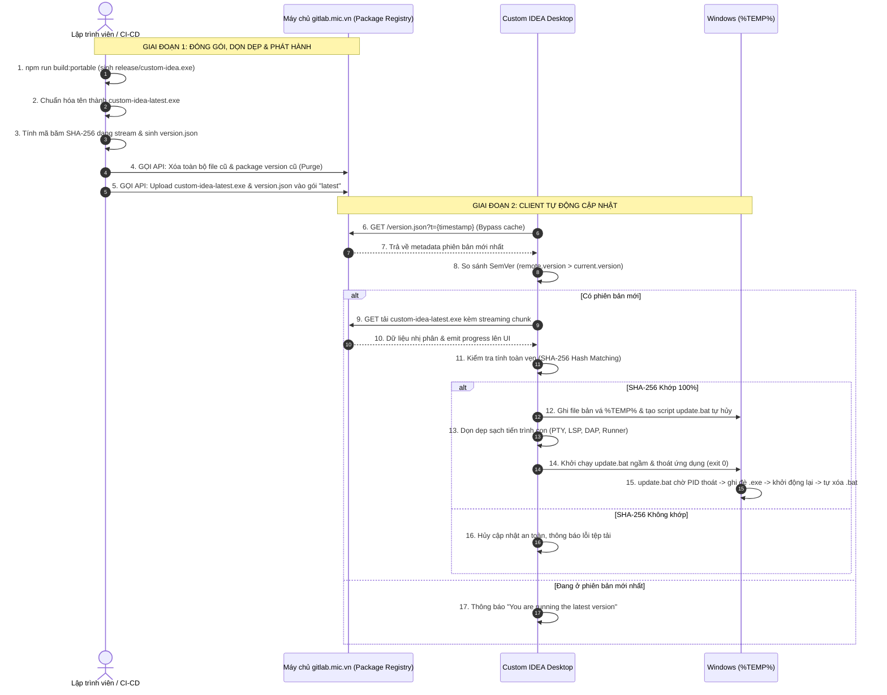

# Auto Update System for Custom IDEA via gitlab.mic.vn

## Overview

Hệ thống **Tự động Cập nhật (Auto Update System)** cho **Custom IDEA** được thiết kế tuân thủ 100% **Tài liệu chuẩn hóa kiến trúc Auto-Update của MIC Studio** (`docs/mic-auto-update-guideline.md`), sử dụng hạ tầng **GitLab Generic Package Registry** nội bộ (`https://gitlab.mic.vn`).

### 3 Thiết Luật Bắt Buộc (Three Iron Rules)
1. **Lưu trữ tại Package Registry - CẤM commit file build vào Git repo:** Toàn bộ tệp `.exe`, bộ cài, thư mục `release/` tuyệt đối không được đưa vào Git. Mọi bản phát hành được đẩy trực tiếp lên GitLab Generic Package Registry của dự án.
2. **Tạo mục (Package) riêng biệt cho ứng dụng:** Package độc lập mang tên `custom-idea`, phiên bản định danh luôn là **`latest`** (Generic Package).
3. **Tên file KHÔNG chứa số version - CHỈ dùng đuôi `-latest` & dọn sạch bản cũ:**
   - Hot-patch nhị phân: `custom-idea-latest.exe`
   - Bộ cài đặt Windows Setup: `custom-idea-Setup-latest.exe`
   - Metadata: `version.json`
   - Cơ chế Purge & Clean: Tự động xóa sạch toàn bộ file cũ và package version cũ trước khi upload tệp mới.

### Cơ Chế Cập Nhật 2 Tầng (2-Tier Update Strategy)
- ⚡ **Tầng 1: Hot-patch Nhị phân (`-latest.exe`):** Tải file `.exe` độc lập siêu nhẹ (~15MB - 35MB), áp dụng tức thì trong 1 - 3 giây qua script `.bat` tự hủy trong `%TEMP%`.
- 📦 **Tầng 2: Full Setup Installer (`-Setup-latest.exe`):** Tải bộ cài đặt Windows Setup khi tệp `version.json` kích hoạt cờ `"requireSetup": true`.
- 🔴 **Hỗ trợ Bắt Buộc Cập Nhật (`forceUpdate: true`):** Khóa giao diện IDE, không cho phép bỏ qua bản cập nhật trọng yếu.

---

## Phases

| Phase | Title | Status | Priority | Effort | File |
| :--- | :--- | :--- | :--- | :--- | :--- |
| **Phase 1** | Kịch Bản Đóng Gói, Dọn Dẹp & Tải Lên GitLab Package Registry | Pending | P1 | 2.5h | [`phase-01-gitlab-package-registry-publish-script.md`](./phase-01-gitlab-package-registry-publish-script.md) |
| **Phase 2** | Client Update Engine: Metadata Check, SHA-256 & Atomic Swapper | Pending | P1 | 3h | [`phase-02-client-update-engine-sha256-swapper.md`](./phase-02-client-update-engine-sha256-swapper.md) |
| **Phase 3** | Giao Diện JetBrains Update Modal, Progress Stream & Force Update | Pending | P1 | 2.5h | [`phase-03-jetbrains-update-modal-force-update-ui.md`](./phase-03-jetbrains-update-modal-force-update-ui.md) |
| **Phase 4** | Tích Hợp System Settings, Menu TopBar & Kiểm Thử E2E Cục Bộ | Pending | P2 | 2h | [`phase-04-settings-menu-integration-and-e2e-testing.md`](./phase-04-settings-menu-integration-and-e2e-testing.md) |

---

## Sequence Diagram (Luồng Thực Thi)

---

## Red Team & Failure Mode Analysis

| ID | Khía cạnh | Rủi ro phát hiện | Biện pháp xử lý triệt để theo tiêu chuẩn MIC |
|:---|:---|:---|:---|
| **RT-01** | **Proxy & Browser Cache** | Proxy mạng nội bộ hoặc client cache lại `version.json` khiến người dùng không nhận được bản mới. | Luôn nối tham số chống cache: `?t=${Date.now()}` vào URL truy vấn metadata. |
| **RT-02** | **Windows File Lock** | Windows khóa file `.exe` đang chạy (`ERROR_SHARING_VIOLATION`), không cho ghi đè trực tiếp. | Tạo kịch bản Batch tự hủy trong `%TEMP%`: dùng vòng lặp `tasklist` kiểm tra PID cũ kết thúc hoàn toàn trước khi `move /y` ghi đè file mới và khởi động lại. |
| **RT-03** | **Tệp tải bị lỗi hoặc can thiệp mạng** | Tải dở dang do chập chờn mạng, file bị hỏng khiến app crash khi chạy. | Bắt buộc đối chiếu mã băm **SHA-256** dạng stream. Chỉ thực thi ghi đè khi hash khớp 100%. |
| **RT-04** | **Quá tải dung lượng Package Registry** | Mỗi lần build sinh ra 30-100MB, lưu dồn nhiều phiên bản làm phình to ổ cứng GitLab. | Kịch bản `publish-update.cjs` thực hiện cơ chế **Purge**: xóa sạch toàn bộ package cũ và tệp cũ trước khi upload. |
| **RT-05** | **Zombie Child Processes** | Khi updater thoát app, các tiến trình con (PTY ConPTY, LSP Language Servers, Runner) có thể bị kẹt lại. | Hàm `cleanup_ide_subsystems()` được gọi trước khi kích hoạt `update.bat`, ngắt dứt điểm mọi tiến trình con. |
| **RT-06** | **Bắt buộc cập nhật bản vá khẩn cấp** | Lỗi bảo mật nghiêm trọng nhưng người dùng liên tục bấm "Remind Me Later". | Hỗ trợ cờ `forceUpdate: true` trong `version.json`: khóa cứng modal, ẩn nút đóng/bỏ qua, buộc cập nhật để tiếp tục dùng. |
